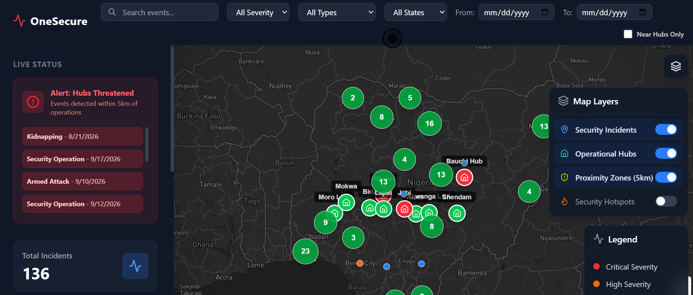
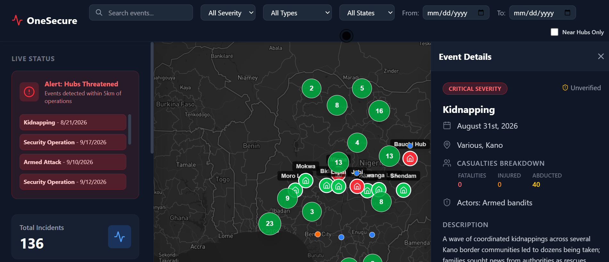

# OneSecure - Security Intelligence Dashboard

Official documentation for the OneSecure project, designed for the GR team. 

OneSecure is a React-based web application that visualizes security events and monitoring hubs (One Acre Fund locations) on an interactive map. It calculates proximity to identify immediate threats, clusters dense event data, and provides comprehensive filtering capabilities for situational awareness and rapid response.

## 📸 Screenshots

### 1. Main Dashboard View

*Displays the main map interface with the sidebar, top navigation, incident details panel, and map clusters.*

### 2. Map Layer Controls

*Shows the interactive map layer controls for toggling security incidents, operational hubs, and proximity zones.*

---

## ✨ Features

- **Google Maps Platform Core:** High-performance, cyber-security dark-themed vector road map built with `@vis.gl/react-google-maps`.
- **Integrated Route Planning & Corridor Exposure:** Driving route computation via the Google Routes API (Maps JavaScript API `Route.computeRoutes`, with a Supabase Edge Function and OSRM as fallbacks), with dynamic corridor threat calculation (2km, 5km, 10km, 25km) comparing alternative routes against recorded security incidents.
- **Explainable Threat Auditing:** Transparent risk scores incorporating incident severity, casualties, verification status, and recency, accompanied by data-freshness and uncertainty disclaimers.
- **Hub-Focused Map:** By default only incidents within 10 km of an operational hub are drawn (5 / 10 / 25 / 50 km or all, via **Show** in the top bar), with faint rings marking each hub's area. Incidents on a selected route's corridor are always shown.
- **Trip Planning Anywhere in Nigeria:** Start and destination can be any place: Google place search, the traveller's current GPS position, a click on the map, an OAF hub or typed coordinates. Route checks use incidents in every state the road passes through (not only operating states), with a look-back of 30 days, 90 days (default), 12 months or all.
- **Journey Guide:** The selected route is split into stretches by the LGA it passes through (reverse-geocoded along the road), each coloured on the map by its own risk and listing its incidents in travel order, with a plain-language summary of the highest-risk stretch, a note when the route leaves the operating states, and a **Start in Google Maps** button for turn-by-turn navigation on the same road.
- **Route Alternatives on the Map:** Up to three driving routes, labelled A / B / C on the map and in the panel, with the selected route colored by corridor risk, alternatives in grey (click either to switch), Safest / Fastest tags and a plain-language recommendation.
- **Incident Reporting (approved staff):** A **Report Incident** button lets approved GR staff add incidents to `security_events`, either through a form or by uploading the downloadable CSV template (same columns as the table, previewed and validated row by row before saving). Reporters type their email, which is checked against an allow-list stored only as SHA-256 hashes (the addresses never appear in the page). Location is filled automatically, with coordinates, state, LGA and place name, from a Google place search, the reporter's current position or a click on the map; uploaded rows without coordinates are geocoded from their location. Requires the **Geocoding API** and **Places API (New)** on the Google key.
- **Incident Download (approved staff):** The **Download** tab in the Incident Reports panel exports incidents by the date they happened (From/To, with last 7/30/90 day shortcuts), optionally for one state or verified only, as a CSV with the `security_events` columns. The file opens in Excel/Google Sheets and uses the same layout as the upload template.
- **Cluster Drill-down:** Clicking a cluster zooms in and draws each of its incidents at its exact location (same-spot reports are fanned out), with **View as list** and **Regroup** options.
- **Guided Tour:** Runs on first visit; replay it any time with the **?** button.
- **Proximity Alerts:** Geodesic distance calculation (via Turf.js) flagging security events within 5 km of One Acre Fund operational hubs in the **past 6 weeks**; older incidents no longer turn a hub red.
- **Security Hotspot Zones:** Canvas heatmap overlay (Google removed `visualization.HeatmapLayer` in Maps JS v3.65) with configurable time-horizons (All Time, 90 Days, 30 Days) and severity weighting.
- **Smart Incident Clustering:** Hierarchical clustering using Supercluster to cleanly aggregate dense incident markers.
- **Advanced Multi-Dimensional Filtering:** Filter incidents by Severity, Verification Status, Event Type, State, and Date Range.
- **Supabase Backend & Edge Functions:** Real-time PostgreSQL database with Edge Functions for secure server-side Google Routes API processing.

---

## 🚀 Getting Started

Follow these instructions to set up the project locally for development and testing.

### Prerequisites

Ensure you have the following installed on your local machine:
- **Node.js** (v18 or higher recommended)
- **npm** (comes with Node.js) or **yarn** / **pnpm**
- **Git**

You will also need accounts/API keys for:
- [Supabase](https://supabase.com/) (Database & Edge Functions)
- [Google Maps Platform](https://console.cloud.google.com/) (Maps JavaScript API & Routes API)

### 1. Clone the Repository

```bash
git clone <your-repository-url>
cd map
```

### 2. Install Dependencies

Install the project dependencies using npm:

```bash
npm install
```

### 3. Environment Variables Setup

Create a `.env` file in the root directory of the project and add your API keys:

```env
VITE_SUPABASE_URL=https://<your-project-ref>.supabase.co
VITE_SUPABASE_ANON_KEY=your_supabase_anon_key
VITE_GOOGLE_MAPS_API_KEY=your_google_maps_browser_key
VITE_GOOGLE_MAP_ID=DEMO_MAP_ID
```

> A Map ID is required for the hub and incident markers (Advanced Markers). The app falls back to Google's `DEMO_MAP_ID` when `VITE_GOOGLE_MAP_ID` is unset; create a custom Map ID in Google Cloud for production.

For the Supabase Edge Function (`calculate-route`), configure the server secret:

```bash
supabase secrets set GOOGLE_MAPS_SERVER_KEY=your_google_maps_server_key
```

### 4. Required Google Cloud APIs to Enable

Enable the following APIs in the [Google Cloud Console](https://console.cloud.google.com/apis/dashboard):
1. **Maps JavaScript API** (Interactive map, markers, controls)
2. **Routes API** (`routes.googleapis.com` for driving directions and alternative routes; used from the browser and the Edge Function). The legacy Directions API is not used.
3. **Geocoding API** and **Places API (New)** (incident report location search and address lookup; the legacy Places API is not used)

### 5. Running and Testing

```bash
# Run unit tests
npm test

# Run linter
npm run lint

# Build production bundle
npm run build

# Start local development server
npm run dev
```

### Staff Sign-in

The app is only available to signed-in One Acre Fund staff (Google sign-in through Supabase Auth). Setup:

1. Google Cloud → OAuth consent screen with user type **Internal** (only the oneacrefund.org Workspace can sign in) and a Web OAuth client whose redirect URI is `https://<project-ref>.supabase.co/auth/v1/callback`.
2. Supabase → Authentication → Google provider enabled with that client ID/secret; Site URL and Redirect URLs set to the site address; email sign-ups turned off.
3. The app also signs out any account not ending in `@oneacrefund.org`, and only offers the Incident Reports tools to the approved risk-team emails.
4. Row-level security policies restrict reads to authenticated `@oneacrefund.org` users and inserts/updates to the risk team (kept outside this repository because they name the approved emails).

The daily collection job uses the service-role key and is not affected.

### Incident Review (risk team)

Collected and reported incidents start as **Unverified** and appear on the map with that label. The approved reporters review them in **Incident Reports → Review**: open the source, confirm with a security contact, correct the details if needed, note how it was confirmed, and choose **Verified**, **Partially verified**, **Disputed** or **Hide from map**. Each review stores who reviewed it, when, and the note. Hidden incidents disappear from the map, totals, routes and downloads but stay in the table.

One-time setup (Supabase → SQL Editor):

```sql
alter table public.security_events
  add column if not exists reviewed_by text,
  add column if not exists reviewed_at timestamptz,
  add column if not exists review_note text,
  add column if not exists is_hidden boolean not null default false;

create policy "Allow incident reviews" on public.security_events
  for update to anon using (true) with check (true);
```

Like the insert policy, this lets anyone with the public anon key update rows; the approved-email check happens in the browser.

### Daily Incident Collection

`.github/workflows/daily-incident-collection.yml` runs `scripts/ingest/index.js` every day at 12:00 Nigeria time (replaces the n8n "GR automated news" workflow):

1. **Research:** the AI searches the web for Nigerian security incidents reported since yesterday.
2. **Extract:** the AI turns its notes into the `security_events` fields (same event types, severity, confidence and verification values as before).
3. **Clean:** the job checks every value; it never takes coordinates or event IDs from the AI.
4. **Place:** coordinates come from Google Geocoding (community → LGA → state, only if the result is in the same state).
5. **De-duplicate:** same article link, or same date ±1 day + state + LGA (or community) + event type, against the last 30 days and within the run.
6. **Save:** new rows get the next `EVT<YYYYMMDD><NNN>` ID and today's `reported_date`.

Each run writes a summary (found / added / duplicates / not placed) on the run page and keeps `ingest-results.json` for 30 days.

**Configuration** (GitHub → Settings → Secrets and variables → Actions):

| Kind | Name | Notes |
|---|---|---|
| Variable | `AI_PROVIDER` | `openai` or `anthropic` |
| Variable | `AI_MODEL` | e.g. `gpt-6-luna`, or `claude-opus-5-5` |
| Variable | `AI_REASONING` | optional, default `low` (`none`/`minimal`/`low`/`medium`/`high`) |
| Secret | `OPENAI_API_KEY` or `ANTHROPIC_API_KEY` | the one matching `AI_PROVIDER` |
| Secret | `SUPABASE_URL`, `SUPABASE_SERVICE_ROLE_KEY` | write access to `security_events` |
| Secret | `GOOGLE_MAPS_SERVER_KEY` | Google key restricted to the Geocoding API, no website restriction |

**Running it by hand:** Actions → *Daily incident collection* → **Run workflow**. Manual runs are dry runs by default (nothing saved); untick *Dry run* to save. An optional date collects one specific day. Switching AI provider only needs the variables and key changed.

### Incident Reporting Setup

Reports are saved in one of two ways:

1. **Recommended: `submit-incident` Edge Function.** It re-checks the reporter's email on the server and inserts with the service role key, so the table can stay closed to direct browser inserts:

   ```bash
   supabase functions deploy submit-incident
   ```

2. **Fallback: direct insert.** If the function is not deployed, the app inserts with the anon key. This only works if row-level security allows it, e.g.:

   ```sql
   create policy "Allow incident reports" on public.security_events
     for insert to anon with check (true);
   ```

   This policy lets anyone holding the public anon key insert rows, so the email check is then only enforced in the browser. Prefer option 1.

To change who can report, update the hash lists in `src/services/incidentReports.js` and `supabase/functions/submit-incident/index.ts` (hash = SHA-256 of the lower-cased email, e.g. `printf %s "name@oneacrefund.org" | sha256sum`). If the table has a `reported_by` (or `reporter_email` / `submitted_by`) column, the reporter's email is stored there.

### 4. Database Schema Requirements (Supabase)

The application expects two primary tables in your Supabase database:

1. **`security_events`**: one row per incident:

   | Column | Example / allowed values |
   |---|---|
   | `event_id` | `EVT20220605001` (EVT + incident date + 3-digit sequence; generated for new reports) |
   | `date` | `2022-06-05` |
   | `state`, `lga`, `location` | `Ondo`, `Owo`, `St Francis Catholic Church, Owo` |
   | `latitude`, `longitude` | `7.1903`, `5.5891` |
   | `event_type` | e.g. Terrorist Attack, Banditry, Kidnapping, Armed Robbery |
   | `severity` | Critical, High, Medium, Low |
   | `description` | free text |
   | `fatalities`, `injured`, `abducted` | whole numbers, `null` when unknown |
   | `actors`, `source`, `source_url` | e.g. `Unknown gunmen`, `Reuters`, link |
   | `source_date`, `reported_date` | dates (`reported_date` is set when a report is submitted) |
   | `confidence` | High, Medium, Low |
   | `verification_status` | Verified, Partially Verified, Unverified |
   | `created_at` | set by the database |

   Only incidents in **states that have an operational hub**, plus the **expansion states Jigawa, Gombe, Oyo and Kano** (`EXPANSION_STATES` in `src/utils/operatingStates.js`), are shown anywhere in the dashboard.

2. **`one_acre_fund_locations`** (Hubs)
   - `id` (uuid/int)
   - `latitude` (numeric/float)
   - `longitude` (numeric/float)
   - `location_name` (text)
   - `state` (text): decides which states' incidents are shown (if empty, the state of the nearest incident within 50 km is used)

### 5. Start the Development Server

Run the following command to start the Vite development server:

```bash
npm run dev
```

Open your browser and navigate to `http://localhost:5173` to view the application.

---

## 🛠️ Built With

* **[React 19](https://react.dev/)** - UI Library
* **[Vite](https://vitejs.dev/)** - Build Tool & Dev Server
* **[Tailwind CSS](https://tailwindcss.com/)** - Utility-first CSS framework
* **[Supabase](https://supabase.com/)** - Backend as a Service (PostgreSQL)
* **[Google Maps Platform](https://developers.google.com/maps)** & **[@vis.gl/react-google-maps](https://visgl.github.io/react-google-maps/)** - Interactive Maps & Routes
* **[Turf.js](https://turfjs.org/)** - Advanced geospatial analysis (Proximity calculations)
* **[Supercluster](https://github.com/mapbox/supercluster)** - Geospatial point clustering

---

## 📁 Project Structure

```
├── public/                 # Static assets
├── src/
│   ├── assets/             # Images, icons, etc.
│   ├── components/         # Reusable UI components
│   │   ├── ClusterPanel.jsx
│   │   ├── DetailsPanel.jsx
│   │   ├── MapArea.jsx
│   │   ├── MapLayerControls.jsx
│   │   ├── Sidebar.jsx
│   │   ├── TopBar.jsx
│   │   └── Tutorial.jsx
│   ├── App.css
│   ├── App.jsx             # Main application logic and state
│   ├── index.css           # Global styles & Tailwind entry
│   ├── main.jsx            # React mounting point
│   └── supabase.js         # Supabase client initialization
├── .env                    # Environment variables (do not commit)
├── package.json            # Project dependencies and scripts
└── vite.config.js          # Vite configuration
```

## 🤝 Contribution Guidelines

For the GR team developers:
1. Create a feature branch (`git checkout -b feature/amazing-feature`).
2. Commit your changes (`git commit -m 'Add amazing feature'`).
3. Push to the branch (`git push origin feature/amazing-feature`).
4. Open a Pull Request.

Make sure to run the linter before committing:
```bash
npm run lint
```
