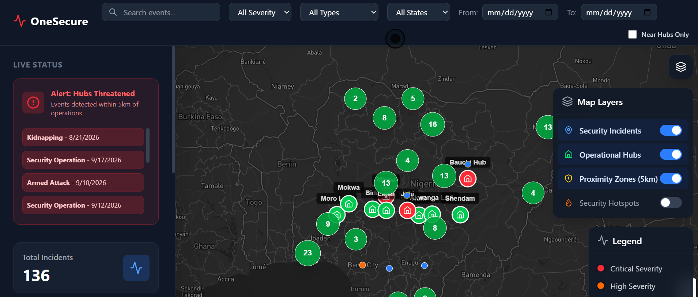
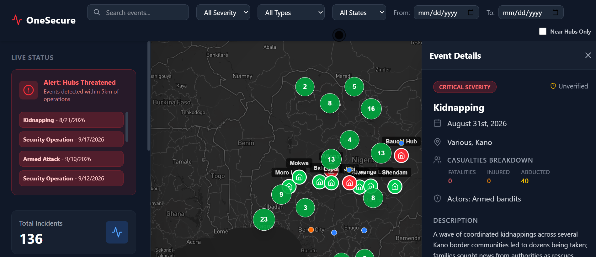

# OneSecure - Security Intelligence Dashboard

Official documentation for the OneSecure project, designed for the GR team. 

OneSecure is a React-based web application that visualizes security events and monitoring hubs (One Acre Fund locations) on an interactive map. It calculates proximity to identify immediate threats, clusters dense event data, and provides comprehensive filtering capabilities for situational awareness and rapid response.

## 📸 Screenshots

### 1. Main Dashboard View

*Displays the main map interface with the sidebar, top navigation, incident details panel, and map clusters.*

### 2. Map Layer Controls

*Shows the interactive map layer controls for toggling security incidents, operational hubs, and proximity zones.*

---

## ✨ Features

- **Google Maps Platform Core:** High-performance, cyber-security dark-themed vector road map built with `@vis.gl/react-google-maps`.
- **Integrated Route Planning & Corridor Exposure:** Driving route computation via Google Routes API (and Supabase Edge Function), with dynamic corridor threat calculation (2km, 5km, 10km, 25km) comparing alternative routes against recorded security incidents.
- **Explainable Threat Auditing:** Transparent risk scores incorporating incident severity, casualties, verification status, and recency, accompanied by data-freshness and uncertainty disclaimers.
- **Proximity Alerts:** Geodesic distance calculation (via Turf.js) flagging security events within 5km of One Acre Fund operational hubs.
- **Security Hotspot Zones:** Google Maps visualization heatmap with configurable time-horizons (All Time, 90 Days, 30 Days) and severity weighting.
- **Smart Incident Clustering:** Hierarchical clustering using Supercluster to cleanly aggregate dense incident markers.
- **Advanced Multi-Dimensional Filtering:** Filter incidents by Severity, Verification Status, Event Type, State, and Date Range.
- **Supabase Backend & Edge Functions:** Real-time PostgreSQL database with Edge Functions for secure server-side Google Routes API processing.

---

## 🚀 Getting Started

Follow these instructions to set up the project locally for development and testing.

### Prerequisites

Ensure you have the following installed on your local machine:
- **Node.js** (v18 or higher recommended)
- **npm** (comes with Node.js) or **yarn** / **pnpm**
- **Git**

You will also need accounts/API keys for:
- [Supabase](https://supabase.com/) (Database & Edge Functions)
- [Google Maps Platform](https://console.cloud.google.com/) (Maps JavaScript API & Routes API)

### 1. Clone the Repository

```bash
git clone <your-repository-url>
cd map
```

### 2. Install Dependencies

Install the project dependencies using npm:

```bash
npm install
```

### 3. Environment Variables Setup

Create a `.env` file in the root directory of the project and add your API keys:

```env
VITE_SUPABASE_URL=https://<your-project-ref>.supabase.co
VITE_SUPABASE_ANON_KEY=your_supabase_anon_key
VITE_GOOGLE_MAPS_API_KEY=your_google_maps_browser_key
VITE_GOOGLE_MAP_ID=DEMO_MAP_ID
```

For the Supabase Edge Function (`calculate-route`), configure the server secret:

```bash
supabase secrets set GOOGLE_MAPS_SERVER_KEY=your_google_maps_server_key
```

### 4. Required Google Cloud APIs to Enable

Enable the following APIs in the [Google Cloud Console](https://console.cloud.google.com/apis/dashboard):
1. **Maps JavaScript API** (Interactive map, visualization heatmap, controls)
2. **Routes API** (`routes.googleapis.com` for driving directions and alternative routes)
3. **Places API / Geocoding API** (For location search and address autocomplete)

### 5. Running and Testing

```bash
# Run unit tests
npm test

# Run linter
npm run lint

# Build production bundle
npm run build

# Start local development server
npm run dev
```

### 4. Database Schema Requirements (Supabase)

The application expects two primary tables in your Supabase database:

1. **`security_events`**
   - `id` (uuid/int)
   - `latitude` (numeric/float)
   - `longitude` (numeric/float)
   - `date` (timestamp/date)
   - `description` (text)
   - `lga` (text)
   - `state` (text)
   - `severity` (text)
   - `event_type` (text)

2. **`one_acre_fund_locations`** (Hubs)
   - `id` (uuid/int)
   - `latitude` (numeric/float)
   - `longitude` (numeric/float)
   - `name` (text) - optional

### 5. Start the Development Server

Run the following command to start the Vite development server:

```bash
npm run dev
```

Open your browser and navigate to `http://localhost:5173` to view the application.

---

## 🛠️ Built With

* **[React 19](https://react.dev/)** - UI Library
* **[Vite](https://vitejs.dev/)** - Build Tool & Dev Server
* **[Tailwind CSS](https://tailwindcss.com/)** - Utility-first CSS framework
* **[Supabase](https://supabase.com/)** - Backend as a Service (PostgreSQL)
* **[Mapbox GL JS](https://docs.mapbox.com/mapbox-gl-js/api/)** & **[react-map-gl](https://visgl.github.io/react-map-gl/)** - Interactive Maps
* **[Turf.js](https://turfjs.org/)** - Advanced geospatial analysis (Proximity calculations)
* **[Supercluster](https://github.com/mapbox/supercluster)** - Geospatial point clustering

---

## 📁 Project Structure

```
├── public/                 # Static assets
├── src/
│   ├── assets/             # Images, icons, etc.
│   ├── components/         # Reusable UI components
│   │   ├── ClusterPanel.jsx
│   │   ├── DetailsPanel.jsx
│   │   ├── MapArea.jsx
│   │   ├── MapLayerControls.jsx
│   │   ├── Sidebar.jsx
│   │   ├── TopBar.jsx
│   │   └── Tutorial.jsx
│   ├── App.css
│   ├── App.jsx             # Main application logic and state
│   ├── index.css           # Global styles & Tailwind entry
│   ├── main.jsx            # React mounting point
│   └── supabase.js         # Supabase client initialization
├── .env                    # Environment variables (do not commit)
├── package.json            # Project dependencies and scripts
└── vite.config.js          # Vite configuration
```

## 🤝 Contribution Guidelines

For the GR team developers:
1. Create a feature branch (`git checkout -b feature/amazing-feature`).
2. Commit your changes (`git commit -m 'Add amazing feature'`).
3. Push to the branch (`git push origin feature/amazing-feature`).
4. Open a Pull Request.

Make sure to run the linter before committing:
```bash
npm run lint
```
